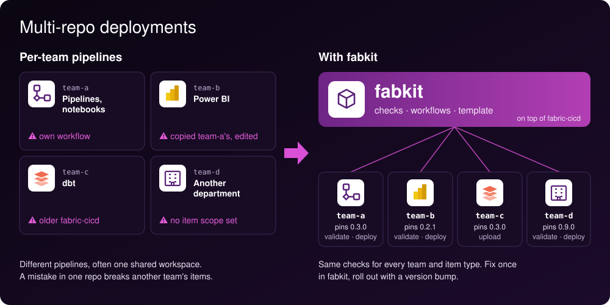

<p align="center"></p>

# xebia-fabkit

fabkit is a CI/CD command for Microsoft Fabric, built on Microsoft's [fabric-cicd](https://github.com/microsoft/fabric-cicd). It adds checks that catch configuration mistakes fabric-cicd lets through, and fails deploys that fabric-cicd reports as successful while leaving items broken.

## Recommended setup

<p align="center"></p>

Each team keeps its own repository and pins a fabkit version. In every repository, pull requests run `fabkit validate`, and a merge deploys with `fabkit deploy`: `dev` to DEV, `preprod` to PREPROD, `main` to PROD. The deployment settings stay in fabric-cicd's own `config.yml` and `parameter.yml`. fabkit has no config file of its own.

GitHub is the only supported platform. Private-link workspaces are not supported.

## Getting started

Start a new repository from the [template](templates/fabric-repo/). It has the `config.yml`, the workflows, the pre-commit hooks and a `Makefile`.

In an existing repository with a fabric-cicd `config.yml`:

```bash
uvx --from xebia-fabkit==0.9.0 fabkit validate
```

## Commands

| Command | What it does |
|---|---|
| `fabkit validate` | Checks the repository for every environment, without logging in. The pull request check. |
| `fabkit deploy --environment PROD` | Runs the same checks for one environment, checks the connections, deploys with fabric-cicd, then runs the uploads. |
| `fabkit upload --environment PROD --lakehouse lh_landing --source dbt/ --target Files/dbt` | Replaces a lakehouse folder with a local folder, without a Fabric deploy. For example a dbt project. |

Run fabkit from the repository root. `fabkit <command> --help` lists the flags.

## What fabkit adds

| Problem | fabric-cicd | fabkit |
|---|---|---|
| Environment key missing or miscased in `parameter.yml` | Skips the replacement | `validate` fails |
| Placeholder (`TODO`, `<...>`) left in a value | Deploys it | `validate` fails |
| Value shaped unlike its `find_value`, e.g. a GUID with a character missing | Deploys it | `validate` fails |
| Same value in every environment | Deploys it | `validate` fails; use `_ALL_` if intended |
| `find_value` that matches no file its filters select | Replaces nothing | `validate` fails |
| Per-environment setting in `config.yml` that leaves out an environment | Ignores the setting there, e.g. deploys every item type | `validate` fails |
| `parameter.yml` that `config.yml` does not reference | Ignores the file | `validate` fails |
| No items in scope while `unpublish.skip` is `false` | Removes every item in scope from the workspace | `validate` fails |
| Two items with the same `logicalId`, or the same type and name | Fails after login, or deploys only one | `validate` fails |
| VariableLibrary override with keys other than `name` and `value` | Fabric rejects the library | `validate` fails |
| VariableLibrary without a value set for an environment | Activates the default value set | `validate` fails |
| `semantic_model_binding` to a model that is not in the repository | Skips the binding | `validate` fails |
| Connection ID the service principal cannot see | Publishes the item unbound and reports success | `deploy` stops before publishing |
| Binding, value-set or unpublish warning during the deploy | Reports success | `deploy` fails |
| Semantic model owned by someone else | Binding fails: only the owner can bind | `deploy --take-over-semantic-models` makes the deploy identity owner first |

The checks also cover the templates under `extend` in `parameter.yml`.

fabkit also requires `unpublish.skip` to be set explicitly, and every environment to map to a workspace in `core.workspace` or `core.workspace_id`. The GitHub Environments use the same names.

## Good to know

- **Values that don't exist yet:** write `PLACEHOLDER`, e.g. for the GUID of a production lakehouse that is not created. `validate` warns; `deploy` fails only when the value would reach the environment being deployed.
- **`$ENV:` values** need their variable only in the deploy of their own environment. A `connection_id` is the exception: fabric-cicd checks every environment's GUID, so put one variable under `_ALL_`.
- **Connections in variable libraries** are checked when the variable name matches `--connection-variables` (default `ConnectionID$`).
- **Uploads** replace the whole target folder. fabkit refuses a folder with files it did not upload, unless `--replace-existing` (`--upload-replace-existing` on `deploy`) is passed. dbt's `target`, `logs` and `profiles.yml` are left out.
- **Semantic model takeover** needs Member or Admin on the workspace, and the tenant setting that lets service principals use Power BI APIs.
- **Debug logging:** set `RUNNER_DEBUG=1`. GitHub sets it on a debug re-run.

## Setup in Azure and GitHub

1. Create an Entra app registration for deploys.
2. Add one federated credential per GitHub Environment. Take the subject from the `azure/login` error of a first, failing run; newer repositories use a subject format that is hard to predict.
3. Create the GitHub Environments, named like the `config.yml` keys, with the secrets `AZURE_CLIENT_ID` and `AZURE_TENANT_ID`. Add protection rules on production.
4. Give the service principal Contributor or higher on each workspace.
5. Share every connection the deploy binds with the service principal.

## Versioning

Versions below 1.0 may change flags between minor releases. Pin an exact version, in the workflows and the pre-commit `rev`, and update it by hand.

## License

MIT
